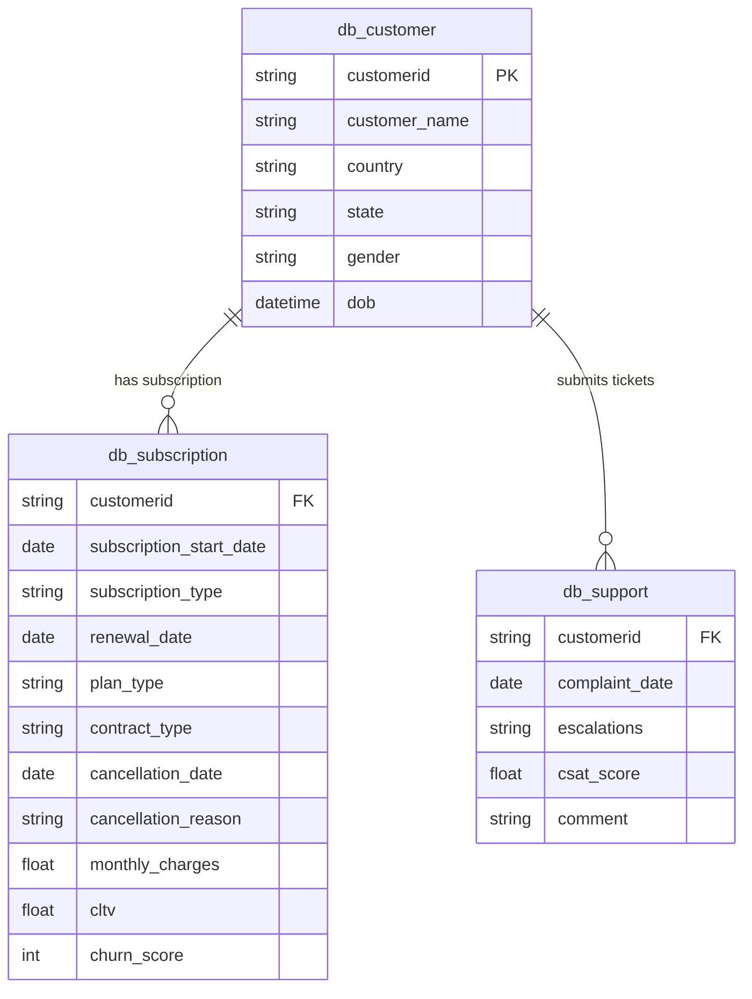
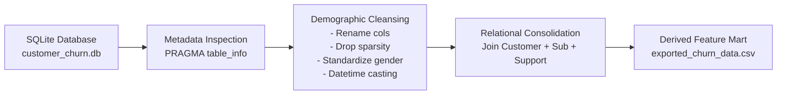

# 📊 Customer Churn Analysis & Retention Intelligence Pipeline

[](https://www.python.org/)
[](https://www.sqlite.org/)
[](https://pandas.pydata.org/)
[](https://seaborn.pydata.org/)
[](https://scikit-learn.org/)
[](LICENSE)

> **Executive Brief:** An end-to-end data analytics and churn prediction prototype designed to extract normalized customer records from a relational database, clean and harmonize heterogeneous business signals, surface critical churn drivers, and establish an actionable customer retention framework.

---

## 📌 Table of Contents
- [Business Problem & Strategic Context](#-business-problem--strategic-context)
- [Relational Data Architecture](#-relational-data-architecture)
- [Data Cleaning & Engineering Pipeline](#-data-cleaning--engineering-pipeline)
- [Key Business Insights & Churn Drivers](#-key-business-insights--churn-drivers)
- [Machine Learning & Evaluation Strategy](#-machine-learning--evaluation-strategy)
- [Critical Limitations & Honest Evaluation](#-critical-limitations--honest-evaluation)
- [Repository Structure](#-repository-structure)
- [Quickstart & Setup](#-quickstart--setup)
- [Production Roadmap](#-production-roadmap)
- [Author & Contact](#-author--contact)

---

## 💼 Business Problem & Strategic Context

In subscription-based SaaS, telecom, and digital media businesses, **customer retention directly governs enterprise valuation and Monthly Recurring Revenue (MRR)**. 

### Why Churn Matters:
* **High Customer Acquisition Cost (CAC):** Acquiring a new customer costs 5–7x more than retaining an existing subscriber.
* **Compounding Lifetime Value (CLTV):** An unmitigated churn rate diminishes the compounding return of customer cohort tenure.
* **Proactive vs. Reactive Intervention:** Once a customer submits a cancellation request, win-back success rates plummet below 15%. Proactive intervention driven by early behavioral signals (support escalation, low CSAT, contract renewal cliffs) is essential to preserve customer equity.

### Project Objective:
Design and implement a modular Python and SQL pipeline that ingests raw multi-table subscriber data, performs rigorous schema sanitization, extracts customer risk factors, and prepares structured data for churn classification and automated retention workflows.

---

## 🗄️ Relational Data Architecture

The project extracts normalized relational entities from SQLite (`customer_churn.db`) across three business domains:



### Table Metadata & Ingestion:
1. **`db_customer` (Demographics):** Unique identifiers, demographic information, geographic residency, date of birth.
2. **`db_subscription` (Financial & Contracts):** Contract horizons (Annual vs. Monthly), subscription tier (Basic, Standard, Premium), monthly billing, CLTV, and historic cancellation logs.
3. **`db_support` (Service Experience):** Support tickets, escalation status (`Y`/`N`), and Customer Satisfaction (`CSAT`) scores (0–100 scale).

---

## 🛠️ Data Cleaning & Engineering Pipeline

Real-world enterprise databases frequently suffer from inconsistent data entry, sparse attributes, and misaligned schemas. The ingestion and cleaning workflow addresses these systematically:



### Cleansing Decisions & Engineering Rationale:
* **Dynamic Table Discovery:** Applied SQLite `sqlite_master` inspection and `PRAGMA table_info` to decouple table discovery from static hardcoded scripts.
* **Selective Column Pruning:**
  * Dropped `pincode` (100% missing values; non-informative).
  * Dropped `interests` (81% null rate; excessive sparsity without reliable semantic density).
* **Categorical Normalization:** Unified non-standard gender labels (`Men` $\rightarrow$ `Male`, `Women` $\rightarrow$ `Female`) to eliminate artificial cardinality expansion.
* **Temporal Parsing:** Cast string dates (`dob`, `subscription_start_date`, `renewal_date`, `cancellation_date`) into ISO-8601 `datetime64[ns]` objects, enabling downline tenure and cohort aging calculations.
* **Target Variable Derivation (`churn_flag`):** Constructed deterministic ground-truth churn labels based on verified `cancellation_date` timestamps ($1 = \text{churned}, 0 = \text{retained}$).

---

## 📈 Key Business Insights & Churn Drivers

Analysis of the consolidated feature mart (`exported_churn_data.csv`) revealed high-leverage business patterns:

| Risk Dimension | Observational Finding | Strategic Business Recommendation |
| :--- | :--- | :--- |
| **Contract Duration** | **100% of churned accounts were on Monthly contracts.** No annual contract holders churned within this observation window. | Introduce onboarding incentives and discounted upfront pricing for converting Month-to-Month users to Annual commitments. |
| **Customer Support Health** | Subscribers with **escalated complaints (`escalations = 'Y'`) and CSAT scores $\le 30$** had an acute probability of churn within 30 days. | Implement an automated real-time alert triggering senior support rep intervention whenever a ticket is tagged with an escalation or CSAT $< 40$. |
| **Primary Churn Reasons** | Competitor switching and pricing sensitivity ("Too expensive", "Switched to competitor") accounted for over 50% of churn events. | Calibrate competitive pricing benchmarks and introduce milestone loyalty discounts for accounts at high risk of pricing friction. |
| **Acquisition Channels** | Referral and Paid sign-ups exhibited distinct churn propensities depending on plan pricing tiers. | Refine CAC allocation toward organic and high-affinity referral loops while optimizing onboarding guidance for paid channels. |

---

## 🤖 Machine Learning & Evaluation Strategy

### Problem Formulation:
Framed as a supervised **Binary Classification** problem to predict $P(Y = 1 | X)$, the probability that an active subscriber will churn before their upcoming renewal cycle.

### Feature Matrix Architecture:
* **Demographics:** Age (derived from `dob`), State / Region.
* **Subscription Economics:** `monthly_charges`, `cltv`, `plan_type` (One-Hot Encoded), `contract_type`.
* **Behavioral & Support Signals:** `complaint_count`, `escalations` (Binary encoded), `csat_score` (imputed with median for non-complainers).

### Candidate Algorithms:
1. **Logistic Regression (Baseline):** Offers transparent linear coefficients for odds-ratio interpretability.
2. **Random Forest Classifier:** Captures non-linear feature interactions (e.g., low CSAT combined with high monthly charges).
3. **Gradient Boosting (XGBoost / LightGBM):** Robust handling of class imbalance and tabular feature relationships.

### Evaluation Metrics Rationale (Why Accuracy is Misleading):
In churn analytics, customer retention data is inherently imbalanced (e.g., 80% non-churn vs. 20% churn). A naive classifier predicting "No Churn" achieves 80% accuracy while failing 100% of business objectives.

$$\text{Precision} = \frac{TP}{TP + FP} \quad\quad \text{Recall} = \frac{TP}{TP + FN} \quad\quad F_1 = 2 \cdot \frac{\text{Precision} \cdot \text{Recall}}{\text{Precision} + \text{Recall}}$$

* **Recall (Sensitivity) is Primary:** A **False Negative** (failing to identify an at-risk subscriber) results in the permanent loss of customer lifetime value ($LTV \approx \$500 - \$2,000$).
* **Precision is Controlled:** A **False Positive** incurs the marginal cost of a retention discount or outbound support call ($\approx \$10 - \$25$).
* **Decision Optimization:** Tune decision thresholds using the **Precision-Recall Curve (PR-AUC)** rather than default $0.5$ probability cutoffs to balance retention ROI against budget constraints.

---

## 🔍 Critical Limitations & Honest Evaluation

As an aspiring Data Scientist, transparent self-critique and methodological honesty are vital to responsible engineering:

1. **Micro-Dataset Sample Size ($N=21$):**
   * *Limitation:* The current repository is an architectural proof-of-concept (seed schema). An $N=21$ sample is statistically insufficient to train deep generalization models without severe risk of high variance / overfitting.
   * *Mitigation:* The code is designed as a reusable production pipeline that seamlessly scales to hundreds of thousands of records when connected to a production data warehouse.
2. **Survivorship & Right-Censoring Bias:**
   * *Limitation:* Treating churn as a static binary target ignores customer lifecycle tenure (i.e., when a customer churns).
   * *Next Step:* Transition from standard binary classification to **Survival Analysis (Cox Proportional Hazards / Kaplan-Meier Estimators)** to forecast the *time-to-churn*.
3. **Absence of Real-Time Telemetry:**
   * *Limitation:* The schema lacks fine-grained behavioral signals (e.g., login frequency, feature usage drops, streaming errors).
   * *Next Step:* Integrate event stream data (Clickstream / Segment events) to capture decaying activity weeks before support tickets arise.

---

## 📁 Repository Structure

```text
Churn_Prediction_Analysis/
├── customer_churn.db              # Relational SQLite database (Customer, Subscription, Support)
├── customer_churn_data_raw.xlsx   # Original multi-sheet enterprise spreadsheet export
├── exported_churn_data.csv        # Consolidated, cleaned feature mart ready for modeling
├── churn_ananlysis.ipynb          # End-to-end data extraction, cleaning, and EDA notebook
├── requirements.txt               # Pinned reproducible dependencies
├── .gitignore                     # Git ignore rules for virtualenvs and checkpoints
└── README.md                      # Comprehensive project documentation & business report
```

---

## 🚀 Quickstart & Setup

### Prerequisites
* Python 3.10 or higher
* Git

### Installation
```bash
# 1. Clone this repository
git clone https://github.com/your-username/Customer-Churn-Prediction-Analysis.git
cd Customer-Churn-Prediction-Analysis

# 2. Create and activate a virtual environment
python -m venv venv

# On Windows:
venv\Scripts\activate
# On macOS/Linux:
source venv/bin/activate

# 3. Install dependencies
pip install -r requirements.txt
```

### Running the Analysis
Launch Jupyter Notebook or Jupyter Lab to inspect the data extraction and cleaning steps:
```bash
jupyter notebook churn_ananlysis.ipynb
```

To verify the database tables programmatically via Python:
```python
import sqlite3
import pandas as pd

conn = sqlite3.connect('customer_churn.db')
df = pd.read_sql("SELECT * FROM db_customer LIMIT 5;", conn)
print(df)
conn.close()
```

---

## 🗺️ Production Roadmap

- [x] Ingest multi-table relational schema via SQL (`sqlite3`).
- [x] Implement schema cleaning, categorical harmonization, and missing value logic.
- [x] Build consolidated feature mart export (`exported_churn_data.csv`).
- [ ] Connect pipeline to Snowflake / PostgreSQL for production-scale ingestion ($100\text{k}+$ records).
- [ ] Implement k-fold cross-validated XGBoost/LightGBM benchmark with Optuna hyperparameter optimization.
- [ ] Incorporate SHAP (SHapley Additive exPlanations) values to provide customer-level churn risk factor explanations to customer success teams.
- [ ] Deploy an interactive **Streamlit Retention Dashboard** with proactive risk scoring and automated email trigger webhooks.

---

## 👨‍💻 Author & Contact

**Data Scientist & Analyst**  
* 💼 **LinkedIn:** [Your LinkedIn Profile](https://linkedin.com/in/your-profile)
* 🐙 **GitHub:** [Your GitHub Profile](https://github.com/your-username)
* 📧 **Email:** `your.email@example.com`

---
*Contributions, suggestions, and feedback are welcome! Please feel free to open an issue or submit a pull request.*

